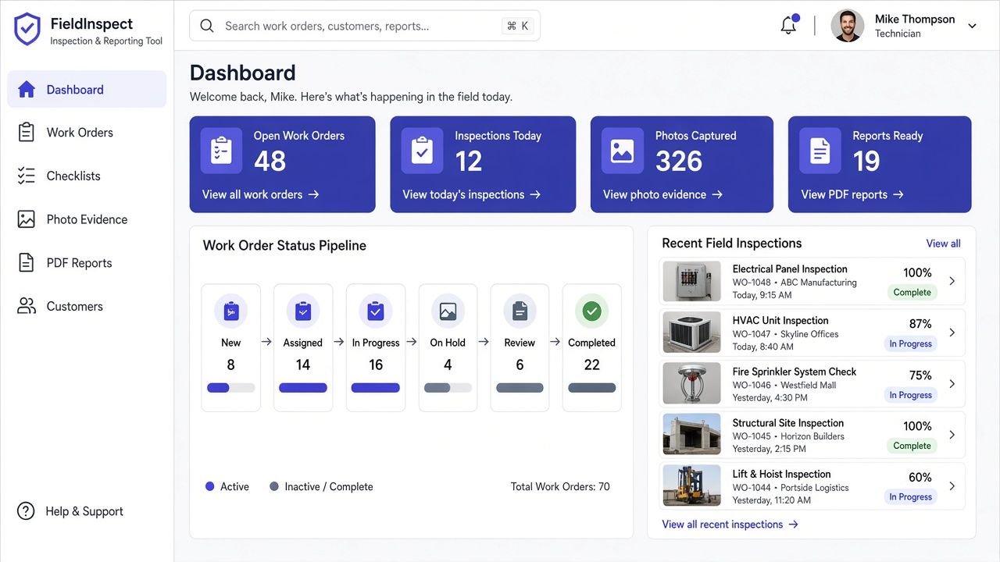

# Field Service Inspection & Reporting Tool



**SEO title:** Field Service Inspection & Reporting Tool — Mobile Checklists, Photo Evidence & PDF Reports  
**SEO description:** Field service inspection and reporting tool with mobile checklists, photo evidence, PDF reports, and customer-ready work summaries for technicians.

**Keywords:** field service inspection, mobile checklist, photo evidence, PDF inspection report, work order dispatch, technician reporting, customer work summary, Laravel Filament field service

---

## Why this product

Paper checklists and WhatsApp photo dumps leave facilities teams without audit-ready proof. **Field Service Inspection & Reporting Tool (FieldInspect)** gives technicians mobile checklists, geotagged photo evidence, Unicode PDF packs, and customer-ready work summaries — with modular toggles so HVAC, fire safety, utilities, and cold-chain operators enable only what they need.

### Business ROI / time saver

| Pain today | With FieldInspect |
|---|---|
| Paper checklists retyped after the visit | Mobile checklist templates with pass/fail scoring |
| Photos scattered across phones | Geotagged photo evidence linked to checklist items |
| Slow, inconsistent customer write-ups | One-click PDF reports + work summaries |
| Dispatch chaos across trades | Work orders with SLA windows and technician assignment |
| Buying tools you do not need | Modular toggles — turn modules on/off per business |

**Demo model:** reclaim **~100+ hours/week** across enabled modules at a blended field-ops rate, with ROI surfaced on the public pricing page and admin widgets.

---

## Stack

- PHP Laravel (latest stable) + Filament admin (`#4338CA` indigo accent)
- Modular feature flags (modules on/off; core inspection modules protected)
- Multi-role users: Super Admin, Admin, Manager, Staff/Technician, Client/Customer, Demo
- Public marketing pages for features, modules, checklists, reports, pricing, demo
- Packagist packages from [imrandevbd](https://packagist.org/packages/imrandevbd/)

### Required packages

- `imrandevbd/drutogoti` — speed layer
- `imrandevbd/laravel-admin-panel` — admin panel foundations
- `imrandevbd/laravel-ai-catalog` — standards / catalog scrape assist
- `imrandevbd/laravel-ai-hub` — AI inspection assist wiring
- `imrandevbd/laravel-attendance-hub` — technician attendance bridge
- `imrandevbd/laravel-unicode-pdf` — multilingual inspection PDF packs
- `imrandevbd/laravel-universal-slug` — Unicode-safe slugs for reports & templates

**Laravel 13 note:** `drutogoti`, `laravel-admin-panel`, and `laravel-attendance-hub` ship as path shims under `packages/*` that require `illuminate/support` `^11|^12|^13` so Composer resolves cleanly while all seven packages remain declared in `composer.json`.

---

## Modules (toggle on/off)

| Key | Module | Category | Core |
|---|---|---|---|
| `customers_sites` | Customers & Sites | crm | Yes |
| `work_orders` | Work Orders | operations | Yes |
| `checklists` | Mobile Checklists | inspection | Yes |
| `inspections` | Field Inspections | inspection | Yes |
| `photo_evidence` | Photo Evidence | evidence | Yes |
| `pdf_reports` | PDF Reports | reporting | No |
| `customer_summaries` | Customer Work Summaries | reporting | No |
| `ai_assist` | AI Inspection Assist | ai | No |
| `catalog_scrape` | Standards Catalog Scraper | data | No (off by default) |
| `attendance_ops` | Technician Attendance | workforce | No (off by default) |
| `speed_optimizer` | Drutogoti Speed Layer | platform | No |

---

## Domain features

- **Customers & sites** — accounts, site codes, access notes, coordinates
- **Work orders** — priority, SLA due windows, technician assignment, status pipeline
- **Checklist templates** — reusable items with critical + photo-required flags
- **Inspections** — on-site runs with pass rate, outcome, and findings
- **Photo evidence** — captions, geotags, checklist item linkage
- **PDF reports** — Unicode-ready packs via `laravel-unicode-pdf`
- **Customer summaries** — headline, body, recommendations for facilities leads
- **Module toggles** — Filament module matrix + env defaults
- **Multi-role Filament admin** — indigo `#4338CA` dashboard for ops teams

---

## Public pages

| Route | Purpose |
|---|---|
| `/` | Hero + KPIs + customers + checklists |
| `/features` | Feature catalog by module category |
| `/modules` | Full module toggle matrix |
| `/checklists` | Published checklist templates |
| `/reports` | PDF reports + customer summaries |
| `/pricing` | ROI / pricing tiers |
| `/demo` | Demo credentials |
| `/admin` | Filament admin panel |

---

## Demo users

Password for all seeded users: `password` (or `DEMO_USER_PASSWORD`)

| Role | Email |
|---|---|
| Super Admin | `admin@field-inspection.test` |
| Admin | `ops-admin@field-inspection.test` |
| Manager | `manager@field-inspection.test` |
| Technician | `tech@field-inspection.test` |
| Client | `client@field-inspection.test` |
| Demo | `demo@field-inspection.test` |

---

## Quick start

```bash
cp .env.example .env
composer install
php artisan key:generate
touch database/database.sqlite
php artisan migrate --seed
php artisan serve
```

Open `http://localhost:8000` (marketing) and `http://localhost:8000/admin` (Filament).

### Docker

```bash
docker compose up --build
```

App: `http://localhost:8080` · MySQL host port `3309`.

---

## Author

**Imran Ahmed** · [imrandev.bd](https://imrandev.bd) · [me@imrandev.bd](mailto:me@imrandev.bd)

---

## 🤝 Let's Connect & Collaborate

I am open to Senior Remote Full-Stack Roles, AI Platform Architecture Contracts, and Enterprise Technical Advisory.

Timezone: UTC+6 (Dhaka / Rangpur, Bangladesh) — Flexible overlap with US, UK, and European business hours.

Delivery Mode: Async-ready, Slack, Discord, Jira, GitHub, and production-first accountability.

| Channel | Address / Handle | Quick Action |
|---|---|---|
| 🌐 Primary Portfolio | [imrandev.bd](https://imrandev.bd) | [Visit Site ↗](https://imrandev.bd) |
| 📦 Packagist Packages | [packagist.org/packages/imrandevbd/](https://packagist.org/packages/imrandevbd/) | [View Packages ↗](https://packagist.org/packages/imrandevbd/) |
| 💼 LinkedIn Profile | [linkedin.com/in/imranbru99](https://linkedin.com/in/imranbru99) | [Connect ↗](https://linkedin.com/in/imranbru99) |
| 🐙 GitHub Profile | [github.com/imranbru99](https://github.com/imranbru99) | [Follow ↗](https://github.com/imranbru99) |
| 💬 WhatsApp Direct | +880 1576-918420 | [Chat Now ↗](https://wa.me/8801576918420) |
| 📧 Direct Email | me@imrandev.bd | [Send Email ↗](mailto:me@imrandev.bd) |
| 🐦 X (Twitter) | [@imrandev_bd](https://x.com/imrandev_bd) | [Follow ↗](https://x.com/imrandev_bd) |
| 📺 YouTube Tech | [@ImranDevBD](https://youtube.com/@ImranDevBD) | [Subscribe ↗](https://youtube.com/@ImranDevBD) |
